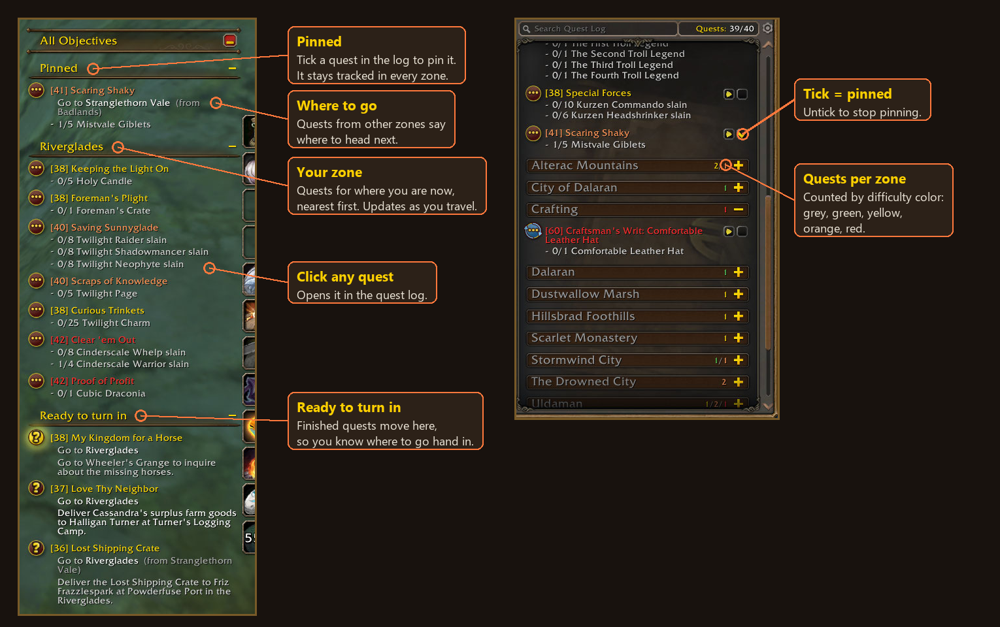

# Quest Pin – CurseForge listing

## Summary (short field)

Tracks the quests for the zone you're in, and keeps the quests you pin tracked everywhere. Nearest first, with finished quests in their own section.

## Description

**Quest Pin** keeps the quest tracker on what matters where you are.

### Features

- **Your zone's quests, tracked automatically.** They change as you travel.
- **Pin a quest to keep it tracked anywhere.** Tick it in the quest log. Pinned quests show where to go and where you got them.
- **Ready to turn in.** Finished quests move to their own section.
- **Nearest first.** Sorted by distance, without jumping around.
- **Click any tracked quest** to open it in the quest log.
- **Difficulty counts** on each zone header in the quest log.
- **Works in dungeons and raids,** and waits until you land to switch zones when flying.
- Uses Blizzard's own tracker and quest log.

### Commands

`/qpin` shows help and settings. `/qpin list` lists pinned quests. `/qpin clear` unpins them all.

### Notes

Made for WoW Forever (Classic-era client).
